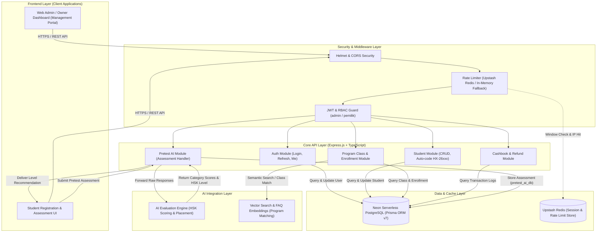

# Haoxing Core API

Centralized backend RESTful API powering administrative workflows, intelligent student placement assessments, class scheduling, and financial management for **Haoxing Mandarin Center** (Capstone Project A26-CS063).

---

## 1. Core Tech Stack

| Layer | Technology | Description |
| :--- | :--- | :--- |
| **Runtime & Language** | Node.js (v22 / LTS), TypeScript 5.8 | Native ES Modules (`"type": "module"`), Strict Mode, Zero `any`. |
| **Framework** | Express.js 5 | Lightweight web framework with modular routing. |
| **Database & ORM** | Neon Serverless PostgreSQL, Prisma ORM v7 | Cloud database with `@prisma/adapter-pg` driver adapter. |
| **Cache & Rate Limiting** | Upstash Redis, ioredis, express-rate-limit | Distributed rate limiting with automatic in-memory fallback. |
| **Authentication & Security** | JWT, bcrypt, Helmet, CORS | Access token (1 day), refresh token (7 days), and role-based access control (`admin`, `pemilik`). |
| **API Documentation** | Swagger UI Express, OpenAPI 3.0 | Documented endpoints accessible at `/api-docs`. |
| **Testing & Coverage** | Vitest, Supertest, @vitest/coverage-v8 | Automated unit and integration testing with V8 coverage engine. |
| **Code Quality** | ESLint 10, Prettier | Consistent code styling and linting standards. |
| **CI/CD** | GitHub Actions | Automated quality gates for `staging` and `main` branches. |

---

## 2. System Architecture & AI Integration

The following architecture diagram illustrates the end-to-end flow connecting Client Applications, Backend Core API, Primary Database, Distributed Cache, and the AI Evaluation Service:



---

## 3. Project Directory Structure

This project follows a **Feature-Based Modular Architecture**:

```text
haoxing-core-api/
├── .github/
│   └── workflows/
│       └── ci.yml             # GitHub Actions CI pipeline
├── docs/
│   ├── code-conventions.md    # Coding and testing conventions guide
│   ├── git-workflow.md        # Branching, PR, and commit message guide
│   ├── erd-db-schema.png      # Entity Relationship Diagram
│   └── flow-system.png        # Business workflow diagram
├── prisma/
│   ├── schema.prisma          # Prisma ORM data models
│   ├── seed.ts                # Initial seeder for Admin, Owner, Classes, and Students
│   └── migrations/            # Database schema migration history
├── src/
│   ├── config/                # Database, environment, Redis, and Swagger configurations
│   ├── middlewares/           # Authentication, rate limiting, and error handling middlewares
│   ├── modules/               # Feature-based business modules
│   │   ├── auth/              # Authentication, refresh token, password, and profile
│   │   │   ├── __tests__/     # Schema, service, and API integration tests
│   │   │   ├── auth.schema.ts
│   │   │   ├── auth.service.ts
│   │   │   ├── auth.controller.ts
│   │   │   └── auth.routes.ts
│   │   └── students/          # Student management module (CRUD)
│   ├── types/                 # Global TypeScript definitions
│   ├── app.ts                 # Express application initialization
│   └── server.ts              # Server bootstrap entry point
├── .env.example               # Environment variables template
├── eslint.config.js           # ESLint flat configuration
├── package.json               # Dependencies and npm scripts
├── tsconfig.json              # TypeScript compiler configuration
└── vitest.config.ts           # Vitest test runner configuration
```

---

## 4. Installation & Setup

### Prerequisites
- Node.js version 20 or 22 (LTS)
- Neon PostgreSQL database instance
- Upstash Redis instance (optional, system falls back to in-memory store)

### Setup Steps

1. **Clone Repository:**
   ```bash
   git clone <REPOSITORY_URL>
   cd haoxing-core-api
   ```

2. **Install Dependencies:**
   ```bash
   npm install --legacy-peer-deps
   ```

3. **Configure Environment Variables:**
   Copy `.env.example` to `.env` and fill in the required credentials:
   ```bash
   cp .env.example .env
   ```

4. **Generate Prisma Client:**
   ```bash
   npm run prisma:generate
   ```

5. **Run Database Migrations:**
   ```bash
   npm run prisma:migrate
   ```

6. **Seed Initial Data:**
   ```bash
   npm run prisma:seed
   ```
   *Default seeded accounts:*
   - **Admin:** `admin@haoxing.id` | Password: `haoxing2026`
   - **Owner:** `pemilik@haoxing.id` | Password: `haoxing2026`

7. **Start Development Server:**
   ```bash
   npm run dev
   ```
   The server will run at `http://localhost:3000`.

---

## 5. Available NPM Scripts

| Script | Description |
| :--- | :--- |
| `npm run dev` | Starts local server with hot-reload (`tsx watch`). |
| `npm run build` | Compiles TypeScript into the `dist/` directory. |
| `npm run start` | Runs production build from `dist/`. |
| `npm run lint` | Runs ESLint check across all files. |
| `npm run lint:fix` | Automatically fixes autofixable ESLint issues. |
| `npm run format` | Automatically formats codebase using Prettier. |
| `npm run format:check` | Checks code formatting without modifying files. |
| `npm run test` | Runs all unit and integration tests using Vitest. |
| `npm run test:watch` | Runs Vitest in interactive watch mode. |
| `npm run test:coverage` | Runs test suite and outputs code coverage report. |
| `npm run prisma:migrate` | Applies database migrations to Neon PostgreSQL. |
| `npm run prisma:generate` | Regenerates local Prisma Client. |
| `npm run prisma:seed` | Populates database with initial seed data. |
| `npm run prisma:studio` | Opens Prisma Studio visual database browser. |

---

## 6. API Documentation

API endpoints, request/response schemas, and Bearer Token authentication are documented and accessible via:

- **Swagger UI:** `http://localhost:3000/api-docs`
- **Health Check:** `http://localhost:3000/api/v1/health`

---

## 7. Git Workflow & Collaboration

All contributors must read and follow the collaboration guidelines:
- **[docs/code-conventions.md](./docs/code-conventions.md)**: Coding standards, naming conventions, Zero `any` rule, and 3-layer testing strategy.
- **[docs/git-workflow.md](./docs/git-workflow.md)**: Branching strategy (`main` for production, `staging` for integration), Conventional Commits format, and PR checklist.
