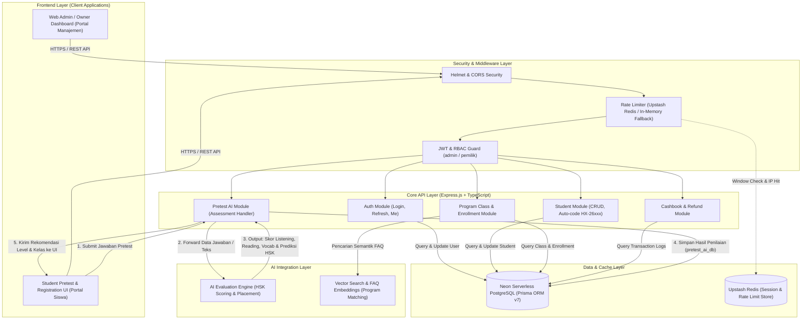

# Haoxing Core API

Backend RESTful API untuk Sistem Manajemen Lembaga Kursus Bahasa Mandarin **Haoxing Mandarin Center** (Capstone Project A26-CS063).

---

## 1. Tech Stack Utama

| Layer | Teknologi | Deskripsi |
| :--- | :--- | :--- |
| **Runtime & Language** | Node.js (v22 / LTS), TypeScript 5.8 | Native ES Modules (`"type": "module"`), Strict Mode, Zero `any`. |
| **Framework** | Express.js 5 | Minimalist web framework dengan modular routing. |
| **Database & ORM** | Neon Serverless PostgreSQL, Prisma ORM v7 | Database cloud serverless dengan driver adapter `@prisma/adapter-pg`. |
| **Cache & Rate Limit** | Upstash Redis, ioredis, express-rate-limit | Rate limiting terdistribusi dengan auto-fallback in-memory store. |
| **Autentikasi & Keamanan** | JWT, bcrypt, Helmet, CORS | Access token (1 hari) & refresh token (7 hari) dengan RBAC (`admin`, `pemilik`). |
| **Dokumentasi API** | Swagger UI Express, OpenAPI 3.0 | Tersedia interaktif di endpoint `/api-docs`. |
| **Testing & Coverage** | Vitest, Supertest, @vitest/coverage-v8 | Unit dan integration test otomatis dengan V8 coverage engine. |
| **Code Quality** | ESLint 10, Prettier | Standar penulisan seragam dan konsisten. |
| **CI/CD** | GitHub Actions | Otomasi gerbang kualitas pada branch `staging` dan `main`. |

---

## 2. Arsitektur Sistem & Alur Integrasi AI

Berikut adalah visualisasi arsitektur end-to-end yang menghubungkan Frontend Client, Backend API, Database, Caching, serta integrasi Layanan AI (Pretest Evaluation & HSK Recommendation):



### Penjelasan Alur Integrasi AI (Pretest Assessment Flow):
1. **Pengerjaan Pretest:** Calon siswa menyelesaikan modul tes kemampuan (listening, reading, dan vocabulary) di frontend.
2. **Evaluasi Otomatis via AI:** Backend meneruskan payload jawaban ke Layanan AI untuk dinilai secara otomatis.
3. **Prediksi Level HSK:** AI menghasilkan skor objektif beserta level HSK yang direkomendasikan (`predicted_level`) dan tingkat keyakinan (`confidence_score`).
4. **Persistensi Data:** Hasil penilaian disimpan ke tabel `pretest_ai_db` dan langsung terhubung dengan profil siswa di `student_db`.
5. **Rekomendasi Kelas:** Backend mengembalikan rekomendasi kelas yang sesuai kepada siswa dan staf admin untuk proses pendaftaran (*enrollment*).

---

## 3. Struktur Direktori Proyek

Arsitektur kode menggunakan pola **Feature-Based Modular Architecture**:

```text
haoxing-core-api/
├── .github/
│   └── workflows/
│       └── ci.yml             # Otomasi pengujian CI GitHub Actions
├── docs/
│   ├── code-conventions.md    # Pedoman standar koding & testing
│   ├── git-workflow.md        # Pedoman percabangan, PR, & commit message
│   ├── erd-db-schema.png      # Diagram ERD Database
│   └── flow-system.png        # Diagram alur sistem bisnis
├── prisma/
│   ├── schema.prisma          # Definisi model data Prisma ORM
│   ├── seed.ts                # Data awal akun Admin, Pemilik, Kelas, & Siswa
│   └── migrations/            # Histori migrasi skema database
├── src/
│   ├── config/                # Konfigurasi database, env, redis, swagger
│   ├── middlewares/           # Middleware autentikasi, rate limit, error handler
│   ├── modules/               # Modul fitur bisnis mandiri
│   │   ├── auth/              # Fitur login, refresh token, ganti password, profile
│   │   │   ├── __tests__/     # Unit test schema, service, dan integration test API
│   │   │   ├── auth.schema.ts
│   │   │   ├── auth.service.ts
│   │   │   ├── auth.controller.ts
│   │   │   └── auth.routes.ts
│   │   └── students/          # Modul manajemen siswa (CRUD)
│   ├── types/                 # Definisi tipe data TypeScript global
│   ├── app.ts                 # Inisialisasi Express app
│   └── server.ts              # Entry point bootstrap server
├── .env.example               # Template environment variable
├── eslint.config.js           # Konfigurasi ESLint flat config
├── package.json               # Daftar dependensi dan script npm
├── tsconfig.json              # Konfigurasi TypeScript compiler
└── vitest.config.ts           # Konfigurasi test runner Vitest
```

---

## 4. Panduan Instalasi & Menjalankan Proyek

### Prasyarat
- Node.js versi 20 atau 22 (LTS)
- Akun database Neon PostgreSQL
- Akun Upstash Redis (opsional, sistem memiliki in-memory fallback)

### Langkah Setup

1. **Clone Repositori:**
   ```bash
   git clone <URL_REPOSITORY>
   cd haoxing-core-api
   ```

2. **Instal Dependensi:**
   ```bash
   npm install --legacy-peer-deps
   ```

3. **Konfigurasi Environment Variable:**
   Salin file `.env.example` menjadi `.env`, lalu isi kredensial yang sesuai:
   ```bash
   cp .env.example .env
   ```

4. **Generate Prisma Client:**
   ```bash
   npm run prisma:generate
   ```

5. **Jalankan Migrasi Database:**
   ```bash
   npm run prisma:migrate
   ```

6. **Jalankan Database Seeder (Membuat Akun Default):**
   ```bash
   npm run prisma:seed
   ```
   *Akun bawaan hasil seeder:*
   - **Admin:** `admin@haoxing.id` | Password: `haoxing2026`
   - **Pemilik:** `pemilik@haoxing.id` | Password: `haoxing2026`

7. **Jalankan Server Development:**
   ```bash
   npm run dev
   ```
   Server aktif di `http://localhost:3000`.

---

## 5. Daftar Perintah NPM (Scripts)

| Perintah | Deskripsi |
| :--- | :--- |
| `npm run dev` | Menjalankan server lokal dengan hot-reload (`tsx watch`). |
| `npm run build` | Melakukan kompilasi TypeScript ke folder `dist/`. |
| `npm run start` | Menjalankan build produksi dari folder `dist/`. |
| `npm run lint` | Memeriksa kepatuhan aturan koding dengan ESLint. |
| `npm run lint:fix` | Memperbaiki error linter yang dapat diselesaikan otomatis. |
| `npm run format` | Merapikan format kode secara otomatis menggunakan Prettier. |
| `npm run format:check` | Memeriksa format kode tanpa melakukan modifikasi file. |
| `npm run test` | Menjalankan seluruh pengujian unit dan integrasi dengan Vitest. |
| `npm run test:watch` | Menjalankan Vitest dalam mode interaktif. |
| `npm run test:coverage` | Menjalankan pengujian dan menampilkan persentase cakupan kode. |
| `npm run prisma:migrate` | Menjalankan migrasi database ke cloud Neon. |
| `npm run prisma:generate` | Memperbarui Prisma Client lokal. |
| `npm run prisma:seed` | Mengisi data awal ke database. |
| `npm run prisma:studio` | Membuka antarmuka grafis data browser Prisma Studio. |

---

## 6. Dokumentasi API Interaktif

Dokumentasi lengkap seluruh endpoint API, skema request/response, dan mekanisme autentikasi Bearer Token dapat diakses langsung melalui browser:

- **Swagger UI:** `http://localhost:3000/api-docs`
- **Health Check:** `http://localhost:3000/api/v1/health`

---

## 7. Alur Kerja Git & Standar Kolaborasi

Seluruh kontributor wajib membaca dan mematuhi panduan berikut sebelum berkontribusi:
- **[docs/code-conventions.md](./docs/code-conventions.md)**: Standar arsitektur, konvensi penamaan, aturan Zero `any`, dan panduan testing 3 layer per modul.
- **[docs/git-workflow.md](./docs/git-workflow.md)**: Alur percabangan 2 branch utama (`main` untuk produksi, `staging` untuk integrasi), format komit Conventional Commits, dan checklist Pull Request.
